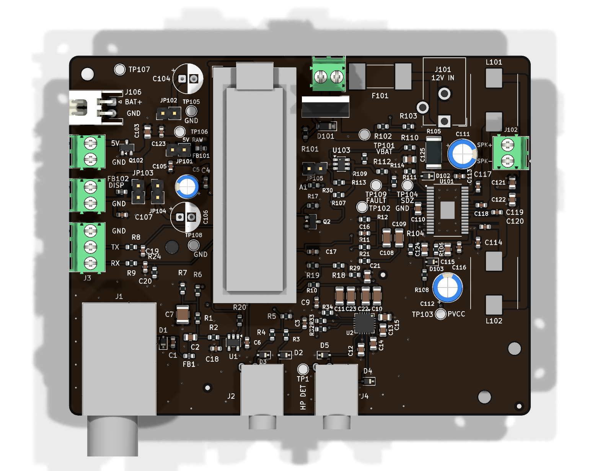
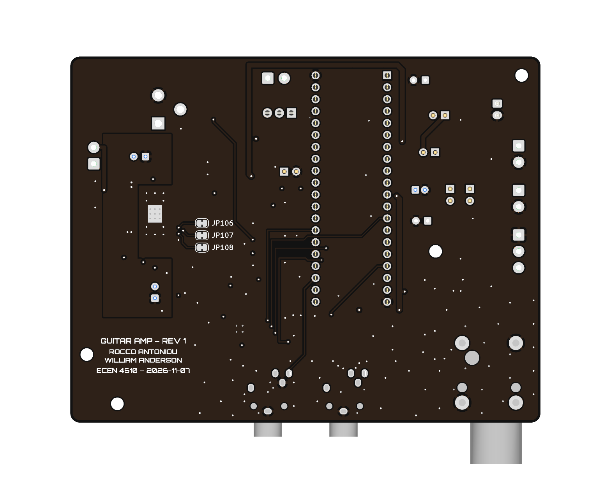

# Amp hardware

The circuit board for our capstone guitar amp, designed in KiCad 10.

The amp board (top, then bottom seen from below):

## The amp board

One 4-layer, 100 × 78 mm board, in `amp-board/`. It holds the Daisy Seed3 that does the audio processing, the guitar and
AUX inputs, an I2C headphone amp (TPA6130A2), the battery input, the 5 V distribution and the class D speaker amp
(TPA3118D2). The Daisy stands upright in the middle and divides the board: audio on its left and in front of it, the
battery entry and class D amp on its right, all over a solid ground plane. The 5 V buck stays off the board. JLCPCB
assembles the surface-mount parts; the rest is soldered by hand from a DigiKey order.

Status: laid out, not ordered. `amp-board/DESIGN.md` lists what is still open.

## Where to look

- `amp-board/DESIGN.md`: how the board works and why, the decisions made, and what is still open
- `amp-board/TEST_PLAN.md`: bring-up and test steps
- `amp-board/amp-board.kicad_pro`: the KiCad project. Part numbers (DigiKey, LCSC) are fields on the schematic's
  parts; the order files are generated from them into `amp-board/fab/`, which git ignores
- Each ordered revision is a git tag (`amp-board-v1`, ...) with its Gerbers, assembly files and DigiKey order attached
  to the GitHub release

## Legacy boards

`legacy/` holds the two boards the amp board grew out of, kept as they were ordered on 2026-11-05: the audio board rev 2
(`legacy/audio-board/`, 2-layer, hand-soldered) and the power board rev 1 (`legacy/power-board/`), joined by screw
terminals and wires. `legacy/README.md` lists their files. They are no longer developed.

## Opening the design

Open `amp-board/amp-board.kicad_pro` with KiCad 10. The board's own footprints, symbols and 3D models are in
`amp-board/lib/`, and the library tables point to them, so no setup is needed.
